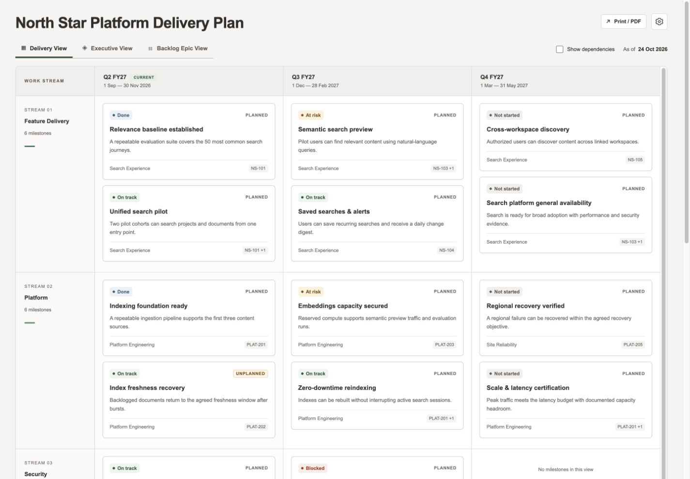

# 🧭 DeliveryPlanner

**Turn complex, multi-team delivery plans into a shared visual story.**

DeliveryPlanner is an AI skill backed by a deterministic Python engine. It transforms one YAML data file into a portable, interactive HTML roadmap that helps delivery teams coordinate work and helps senior stakeholders understand progress, dependencies, risks, and decisions.

## 🎯 The problem it solves

Delivery rarely follows a single team's backlog. Outcomes span teams, platforms, security reviews, operational readiness, and multiple quarters. The information needed to understand the whole programme often ends up scattered across trackers, spreadsheets, and presentation decks.

DeliveryPlanner brings that context together in one maintained plan, with different views for different conversations. Teams can explore the work and its dependencies; executives can focus on outcomes and decisions; backlog discussions can trace milestones to their related epic keys.

## ✨ What you get

- **A graph-style roadmap:** compact milestone nodes, floating stream labels, dated periods, and dependency lines routed around cards.
- **Three stakeholder views:** Delivery, Executive, and Backlog Epic, generated from the same source.
- **Clear delivery signals:** status, planned/unplanned work, accountable teams, exact target dates, and authored reporting commentary.
- **Direct epic references:** Jira or Rally keys live on milestones—no separate epic registry to maintain.
- **Useful interactions:** search, filters, dependency highlighting, keyboard scrolling, milestone details, and configurable display settings.
- **Portable output:** one self-contained `delivery_plan.html` with inline assets, ready to open locally or share through your chosen channel.
- **Repeatable generation:** identical source data and renderer inputs produce identical HTML bytes. Reporting calculations use the plan's reporting date rather than the current clock.



*North Star Platform Delivery Plan is a fictional public example with 32 milestones, four streams, six teams, and five quarters. It is also the maintained development fixture.*

## 👥 One plan, three perspectives

| View | Purpose |
| --- | --- |
| **Delivery View** | Coordinate milestones across teams, streams, and periods; explore direct dependencies and delivery status. |
| **Executive View** | Review selected outcomes, programme highlights, risks, decisions, and full-plan delivery exceptions. |
| **Backlog Epic View** | Group milestones by their Jira/Rally epic keys and see the delivery outcomes associated with each epic. |

These views change presentation, not access permissions. The HTML contains the full plan data.

## 🤖 How the skill works

The AI agent helps you maintain the plan and invoke the appropriate operation. Validation, scaffolding, rendering, and publishing are implemented in code rather than generated ad hoc by the model.

| Operation | Result |
| --- | --- |
| **Create `<name>`** | Scaffold a plan folder with a commented YAML template. |
| **Validate** | Check structure, references, dates, dependency consistency, and delivery warnings. |
| **Update** | Validate the YAML and regenerate `delivery_plan.html`. |
| **Publish** | Regenerate and copy the HTML to a designated local or mounted folder. |

The skill instructions are in [SKILL.md](Skills/delivery-planner/SKILL.md). This repository also includes a `.agents/skills/delivery-planner` discovery link to the canonical skill directory.

Example requests to an agent using the skill:

> Create a delivery plan called Customer Experience Platform.
>
> Validate the North Star Platform plan and explain any warnings.
>
> Update the North Star HTML from its YAML data file.
>
> Publish the North Star plan to the folder I specify.

Tracker keys are references, not live integrations. DeliveryPlanner does not fetch tracker status, infer executive commentary, or send stakeholder messages. Publish copies an artifact; it does not deploy a website.

## 🚀 Quick start

Prerequisites: Python 3.9 or later and `uv` for the pinned environment. Node.js is used for the JavaScript development checks.

```sh
git clone https://github.com/git-mhaque/DeliveryPlanner.git
cd DeliveryPlanner
uv sync --frozen --project Skills/delivery-planner
```

Validate and regenerate the maintained example:

```sh
Skills/delivery-planner/.venv/bin/python Skills/delivery-planner/scripts/delivery_planner.py --root "$PWD" validate north-star-platform
Skills/delivery-planner/.venv/bin/python Skills/delivery-planner/scripts/delivery_planner.py --root "$PWD" update north-star-platform
```

Open `Plans/north-star-platform/delivery_plan.html` in your browser. On macOS:

```sh
open Plans/north-star-platform/delivery_plan.html
```

Create your own plan:

```sh
Skills/delivery-planner/.venv/bin/python Skills/delivery-planner/scripts/delivery_planner.py --root "$PWD" create "Customer Experience Platform"
```

Edit `Plans/customer-experience-platform/plan.yaml`, then run Validate and Update for `customer-experience-platform`.

Publish to a folder you choose:

```sh
Skills/delivery-planner/.venv/bin/python Skills/delivery-planner/scripts/delivery_planner.py --root "$PWD" publish north-star-platform --to /path/to/published-plans
```

## ⌨️ Exploring a plan

- Click empty roadmap space, then use **← ↑ ↓ →** to scroll across quarters and streams.
- Use **Tab** to move between milestones and **Enter** to open details.
- Select a milestone to highlight its direct connections. Press **Esc** or click outside cards to clear selection.
- Open **Settings** to show counts, filters, programme health, the summary, or dependency lines. **Show all** and **Hide all** toggle them together.
- Dependency lines are enabled by default in new plans. Other optional panels start hidden; display preferences reset on reload.

## 📁 Repository layout

```text
DeliveryPlanner/
├── Plans/
│   └── north-star-platform/
│       ├── plan.yaml                 # Source of truth
│       └── delivery_plan.html        # Generated, portable output
├── Skills/
│   └── delivery-planner/
│       ├── SKILL.md                  # Agent instructions
│       ├── assets/                   # Scaffold and shared renderer templates
│       ├── references/               # Schema and data model
│       ├── scripts/                  # Deterministic CLI and engine
│       └── tests/                    # Engine and geometry checks
├── .agents/skills/delivery-planner    # Link to the canonical skill
├── docs/                             # Specification, verification, and previews
└── AGENTS.md                         # Contributor instructions
```

## 🛠️ Development and verification

Edit shared templates rather than generated HTML, then regenerate the maintained plan.

```sh
Skills/delivery-planner/.venv/bin/python -m pytest Skills/delivery-planner/tests -q
node --test Skills/delivery-planner/tests/graph-layout.test.cjs
node --check Skills/delivery-planner/assets/templates/plan.js
node --check Skills/delivery-planner/assets/templates/graph-layout.js
```

The current suite includes 43 engine tests and five graph geometry tests. Browser checks cover the interactive views, filtering, selection, and responsive layouts. Actual PDF pagination and broader browser compatibility remain manual checks. Zoom and drag-to-edit are not implemented.

Read the [data model](Skills/delivery-planner/references/data-model.md), [implementation specification](docs/delivery-planner-spec.md), [verification notes](docs/verification.md), and [contributor instructions](AGENTS.md) for more detail.
